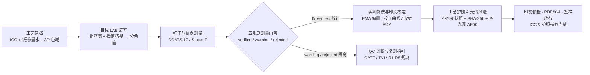

# 色彩工坊（Color Workshop）

[](https://github.com/11122313211/color-workshop/actions/workflows/ci.yml)
[](./requirements.txt)
[](./app/main.py)
[](./LICENSE)

> 面向印前工程的**色彩数值优化与光谱证据闭环平台**（FastAPI + 原生 ES Module + Three.js，零前端构建，MIT 许可）。

以 CIEDE2000（$\Delta E_{00}$）为统一度量，以**工艺 ICC 数值优化 + 方法学测量门禁 + 不可变工艺护照**为主线，打通从目标色反查分色值、实测验证与误差补偿、印刷质量诊断与校准收敛，到印前预检、PDF/X-4 封装与签样放行的完整印前闭环。

---

## 核心闭环工作流



---

## 核心能力一览

| 业务域 | 核心功能 |
|---|---|
| **工艺库与 2D/3D 色域** | 以“打印机 + 纸张 + 墨水 + ICC”为一等实体；支持 ICC 解析/替换/下载、2D CIE 1931 色度图、WebGL 真 3D 色域体积（Qhull 包络 + $L^*$ 切片 + 回退链）、双工艺色域交集对比。 |
| **LAB → CMYK 配方反查** | 支持 CMYK / RGB / GRAY 通道泛化；17⁴ 粗查表 + 多线性插值精搜层（插值引导、真实 `lcms2` 正向变换定夺，打破 8-bit 平台期）；明确标注 `recipe_kind="device_values"`（分色设备值），支持批量 CSV 与 JSON/Markdown 配方单导出。 |
| **实测验证与补偿学习** | 回填分光光度计实测 Lab 后做模型误差补偿并重新反查；通过 `verified` 测量门禁的修正结果按 EMA（$\alpha=0.35$，通道截幅 $\pm 15\%$）沉淀为工艺级偏置，ICC 变更自动失效。 |
| **可信测量闭环与印刷 QC** | 解析 CGATS.17（光谱/Lab/XYZ/RGB 乱序容错）与 Status-T 密度 TSV；五条规则自动分级（复测一致性、纸白比对、Lab↔XYZ/光谱交叉校验、物理量程、梯尺 3σ MAD 离群）；仅消费 `verified` 计算 GATF 四指标、Murray–Davies TVI、反差率 $K$、叠印率 $T$、灰平衡与均匀性，输出 R1–R8 规则诊断、双会话 Δ 对比、A4 双点验证样张与主观评价检查单。 |
| **印刷校准与收敛追踪** | 生成 ISO 12647-7 风格编号校准版（28 色块 × 双点）；输出「工艺 ICC 预期 + ISO 12647-2 涂布纸固体参考」双基准差距报告、Lab 有效网点反演校正曲线（ISO 10128 变体）、逐通道墨量建议（幂等落库轮次并判定收敛趋势）与特性数据 CGATS 导出。 |
| **印前预检、PDF/X-4 与显示器门禁** | 图像/PDF 深度预检（字体真嵌入、TrimBox/BleedBox 出血、内容流 CTM 有效 DPI、标准开本、缩略图）；PDF/X-4 结构封装（OutputIntent + XMP + 盒子，严格模式拦截未嵌入字体与未标定 RGB）；显示器校准档案、屏幕 XYZ 测量导入导出与软打样可信门禁。 |
| **工艺护照、光谱风险与签样放行** | 版本化不可变工艺护照（聚合 ICC、补偿、校准、测量、配方与光谱覆盖，规范化 JSON SHA-256，动态判定 `valid/incomplete/stale/invalid`，保留历史与签样引用）；四光源（D50 / D65 / A / CIE F11，2°）工程同色异谱风险评估；签样状态机（草稿 → 待审 → 批准/驳回 → 锁定放行令牌），ICC 或护照变更自动触发门禁拦截。 |
| **生命周期与数据完整性** | 删除改为**归档优先**（归档工艺只读可恢复，写操作统一返回 `409 PROCESS_ARCHIVED`）；显式永久清理删除派生数据、解绑保留测量/评价、签样标为只读孤儿；内置完整性审计与 Dry Run 预览修复工具（UI + CLI）。 |

---

## 技术栈与项目结构

- **后端**：Python 3.12+、FastAPI、Uvicorn、Pydantic v2、JSON 原子持久化（按路径锁 + 读缓存 + `fsync` + 坏库自动隔离）
- **色彩与印前引擎**：`lcms2`（经 Pillow `ImageCms`）、`colour-science`、`coloraide`、`numpy`、`scipy`（Qhull）、`pypdf`、`pypdfium2`
- **前端**：原生 ES Module + HTML5 Canvas + Three.js r187（本地 vendored，无 Node 构建链），亮/暗主题自适应，移动端响应式布局与键盘无障碍支持

```text
color-workshop/
├── app/
│   ├── main.py                      # FastAPI 入口、CORS 策略与静态资源挂载
│   ├── algorithms/core.py           # 色彩空间转换、批量 ΔE、色域体积与覆盖率
│   ├── ai/color_checker.py          # 色卡检测与闭环校正工具
│   ├── models/schemas.py            # 严格 Pydantic 模型（拒绝 NaN/Inf、边界校验）
│   ├── routers/
│   │   ├── _http.py                 # 流式体积限流、RFC 5987 下载头、缺失 ICC 409 工具
│   │   ├── processes.py             # 工艺库 CRUD / 归档 / 恢复 / 永久清理 / 色域
│   │   ├── recipes.py               # 配方预测 / 正查 / 实测验证 / 趋势与漂移监控
│   │   ├── qc.py                    # 测量导入 / QC 指标 / 对比趋势 / 评价 / 校准闭环
│   │   ├── files.py                 # 印前预检 / ICC 软打样转换 / PDF/X-4 封装
│   │   ├── signoffs.py              # 签样状态机 / 放行门禁 / 交接清单
│   │   ├── displays.py              # 显示器校准档案 / 软打样门禁 / 屏幕测量
│   │   ├── passport.py              # 工艺护照生成 / 版本历史 / 导出
│   │   ├── spectral.py              # 多光源同色异谱风险与会话光谱比对
│   │   ├── integrity.py             # 数据完整性扫描与 Dry Run / 修复接口
│   │   └── main.py                  # 基础色彩计算与工具箱端点
│   └── services/                    # 领域服务层（filedb / recipe / cgats / measurement_qa /
│                                    #   density / diagnosis / calibration / pdfx / passport /
│                                    #   spectral / lifecycle / integrity 等）
├── static/
│   ├── index.html                   # SPA 外壳（桌面侧边栏 + 窄屏底部导航与主题切换）
│   ├── css/app.css                  # 设计令牌、组件样式、暗色主题与响应式适配
│   ├── vendor/three/                # Three.js r187 本地依赖（MIT，含完整性校验记录）
│   └── js/                          # 路由、API 客户端、Canvas/WebGL 色域组件与各业务视图
├── .github/workflows/ci.yml         # GitHub Actions 自动化测试工作流（Ubuntu + Python 3.12）
├── scripts/                         # 完整性审计 CLI、数据清理、HTTP E2E 与截图脚本
├── tests/                           # 290 项自动化测试（含 MIT 测试 ICC 与精度基线）
├── docs/                            # 架构设计与版本演进文档
├── CHANGELOG.md                     # Keep a Changelog 版本变更记录
├── pytest.ini                       # Pytest 测试配置与标记（precision / slow / api）
├── requirements.txt
├── .editorconfig                    # 跨平台编码、缩进与换行符规范
└── LICENSE
```

---

## 快速开始

### 1. 环境准备与启动

```bash
# 克隆仓库并进入项目目录
git clone https://github.com/11122313211/color-workshop.git
cd color-workshop

# 安装 Python 依赖（推荐 Python 3.12+）
pip install -r requirements.txt

# 启动本地服务（默认端口 2354）
python -m uvicorn app.main:app --host 127.0.0.1 --port 2354
# 或直接运行模块入口（读取 COLORFORGE_HOST / COLORFORGE_PORT，默认 127.0.0.1:2354）
python -m app.main
```

启动后访问：
- **Web 应用**：`http://127.0.0.1:2354/`
- **交互式 API 文档（Swagger UI）**：`http://127.0.0.1:2354/docs`

### 2. 可选环境变量

| 环境变量 | 默认值 | 说明 |
|---|---|---|
| `COLORFORGE_HOST` | `127.0.0.1` | `python -m app.main` 启动时的监听地址 |
| `COLORFORGE_PORT` | `2354` | `python -m app.main` 启动时的默认监听端口 |
| `COLORFORGE_DATA_DIR` | `./data` | 运行时 JSON 与 ICC 存储目录（用于多环境/测试隔离） |
| `COLORFORGE_CORS_ORIGINS` | 本地 `localhost`/`127.0.0.1` | 逗号分隔的允许跨域来源列表 |
| `COLORFORGE_E2E_BASE_URL` | `http://127.0.0.1:2354` | HTTP E2E 脚本指向的目标服务地址 |

---

## 测试与 CI

项目内置 290 项跨平台自动化测试（包含 MIT 许可测试 ICC、API 集成测试与精度基线回归门禁，配置见 [pytest.ini](pytest.ini)），并通过 GitHub Actions（[.github/workflows/ci.yml](.github/workflows/ci.yml)）在每次推送或拉取请求至 `main` 分支时自动在 Ubuntu + Python 3.12 环境执行 `pytest -q`。

```bash
# 全量自动化测试（290 项，内置 MIT 测试 ICC，跨平台可直接运行）
python -m pytest -q

# 仅运行精度基线回归门禁（算法重构或依赖升级前后推荐）
python -m pytest -m precision -q

# 数据完整性审计（默认只读 Dry Run，不写盘）
python scripts/audit_data.py --dry-run

# 应用完整性修复（删除孤儿派生记录、解绑测量/评价、标记孤儿签样、隔离未引用 ICC）
python scripts/audit_data.py --apply

# HTTP 端到端验证（需先启动服务）
python scripts/e2e_http.py
```

---

## 核心 API 速查

| 模块 | 主要端点 |
|---|---|
| **工艺与生命周期** | `GET/POST /api/processes`、`GET/PATCH/DELETE /api/processes/{id}`、`GET/PUT /api/processes/{id}/icc`、`GET /api/processes/{id}/gamut`、`GET /api/processes/{id}/gamut/compare`、`POST /api/processes/{id}/archive\|restore`、`DELETE /api/processes/{id}/permanent?confirm={id}`、`GET /api/processes/{id}/dependencies` |
| **配方预测与监控** | `POST /api/recipes/predict`、`POST /api/recipes/verify`、`POST /api/recipes/forward`、`GET /api/recipes`、`GET /api/recipes/stats`、`GET /api/recipes/{rid}/export?format=json\|md` |
| **测量、QC 与校准** | `POST/GET/DELETE /api/qc/measurements`、`POST /api/qc/measurements/import`、`GET /api/qc/ink-quality`、`GET /api/qc/compare`、`GET /api/qc/trend`、`POST /api/qc/testform`、`GET/POST/DELETE /api/qc/evaluations`、`POST /api/qc/calibration/form`、`GET /api/qc/calibration`、`POST /api/qc/calibration/apply`、`GET /api/qc/calibration/history` |
| **印前与软打样** | `POST /api/files/preflight`（支持图像/PDF、工艺护照指纹门禁与 PrintGuard 机读 JSON 消费）、`POST /api/files/preflight/printguard`、`POST /api/files/spot-check`（专色色域/$\Delta E_{00}$ 核验）、`POST /api/files/convert`、`POST /api/files/pdfx`、`GET/POST /api/displays`、`POST /api/displays/{id}/activate\|calibrations\|measurements`、`GET /api/displays/active-status` |
| **护照、光谱与签样** | `GET/POST /api/processes/{pid}/passport`、`GET /api/processes/{pid}/passport/versions`、`GET /api/processes/{pid}/passport/{v}/export`、`POST /api/spectral/metamerism`、`POST /api/spectral/compare`、`GET /api/spectral/sessions/{sid}/summary`、`GET/POST /api/signoffs`、`POST /api/signoffs/{id}/submit\|approve\|reject\|withdraw\|lock`、`GET /api/signoffs/gate`、`GET /api/signoffs/release-manifest` |
| **完整性与基础工具** | `GET /api/integrity/report`、`POST /api/integrity/repair`、`POST /api/convert`、`POST /api/delta-e/lab`、`GET /api/visualization/gamut`、`GET /api/health` |

---

## 算法口径、安全边界与数据合规

- **诚实预测口径**：正向变换基于 `lcms2` CMM，所有返回的 `predicted_lab` 与 $\Delta E_{00}$ 均为真实变换结果；插值精搜层仅做候选引导，须经真实正向评估严格更优才接受；色域外目标如实返回最优可印分色值并标注超差，不伪造收敛。
- **测量与光谱边界**：
  - 光谱积分覆盖 `380–730 nm` 网格，四光源（D50 / D65 / A / CIE F11，2°）独立积分不强行重采样；风险分级（$\le 1.0$ 低 / $\le 2.0$ 中 / $> 2.0$ 高）明确为**工程同色异谱风险筛查指标，不等同 CIE 15 特殊同色异谱指数 MI**。
  - 所有色彩转换端点对无 ICC 语义的通用 `"cmyk"` 返回 `422`，CMYK 转换统一经工艺 ICC 执行。
- **印前结构预检与渲染验证边界**：结构预检（OutputIntent / XMP / 页面盒 / 字体嵌入）不证明页面存在可见内容；PDF 预检与 PDF/X-4 封装后经 `pypdfium2` 按 72 DPI（可配置，超 20 页采用首 2 + 尾 2 + 中间均匀抽样）光栅化统计非白像素占比（RGB 任一通道 `< 250`）：单页 `< 0.1%` 报警 `blank_page_suspect`（`warning`，保留产物不静默通过），封装前后相对偏差 `> 5%` 报警 `ink_drift_suspect`（`rejected`，保留产物并在签样门禁拦截）；本防线仅做墨量级内容核验（不做像素级视觉 diff），**不等同亦不替代** Acrobat Preflight / callas pdfToolbox / PitStop 等商业 PDF/X 合规认证。
- **并发与安全防护**：
  - 存储层支持进程内跨实例路径锁、读缓存、`allow_nan=False` 严格 JSON 写入及原子替换；单机轻量部署适用，多 Worker 生产部署建议替换为外置锁或数据库事务。
  - 全部上传接口施加流式体大小上限与后台线程卸载，文件下载统一使用 RFC 5987 编码头，前端模板全量转义防 XSS 并支持路由切换自动中止在途请求。
- **数据合规声明**：本仓库不包含任何真实业务生产数据或个人隐私信息；所有内置测试资产均为开源许可测试 profile（见 [THIRD-PARTY-LICENSES.md](tests/fixtures/icc/THIRD-PARTY-LICENSES.md)）或代码生成的合成样本；运行时 `data/` 目录已被 `.gitignore` 排除。

---

## 版本演进

完整变更明细请查阅 [CHANGELOG.md](CHANGELOG.md)。

- **V0.11（当前优化版）**：归档优先生命周期、完整性扫描与 Dry Run 修复、护照历史与签样引用、无障碍增强；以及全项目审计优化（跨实例存储并发锁、算法向量化与零警告、ICC 纸白校验/复测 QA/校准幂等/漂移公式修复、路由流控与 N+1 消除、前端 Display-P3 OETF 修正与泄漏治理、测试扩充至 277 项，后续持续迭代至 290 项）。
- **V0.10**：版本化不可变工艺护照、`device_values` 配方语义、四光源光谱同色异谱风险评估与签样护照门禁。
- **V0.9**：PDF 深度预检（字体嵌入/出血/有效 DPI/开本）、PDF/X-4 结构封装、签样状态机与显示器软打样门禁。
- **V0.7 – V0.8**：ISO 12647-7 风格编号校准版、双基准校准报告、Lab 有效网点反演校正曲线与多轮收敛追踪。
- **V0.5 – V0.6**：CGATS.17 / Status-T 解析、五规则测量可靠性闭环、GATF 油墨指标与 TVI、R1–R8 规则诊断、主观评价检查单。
- **V0.1 – V0.4**：工艺库、LAB→CMYK 反查引擎与插值精搜、EMA 补偿模型、Three.js 真 3D 色域体积与 ΔE 监控趋势。

---

## 开源许可

本项目采用 [MIT License](LICENSE) 开源。第三方资产许可单独注明：
- 测试 ICC 资产：[tests/fixtures/icc/THIRD-PARTY-LICENSES.md](tests/fixtures/icc/THIRD-PARTY-LICENSES.md)
- 本地内嵌 Three.js r187：`static/vendor/three/`（MIT 许可，含 SHA-512 校验记录）
